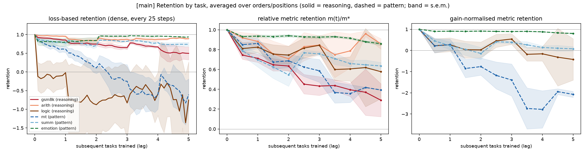
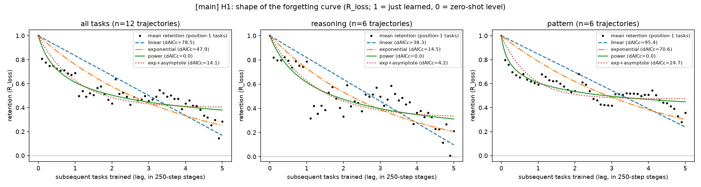
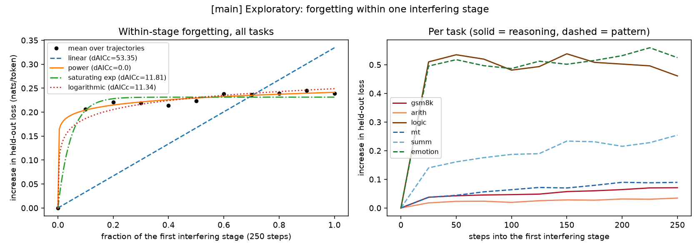
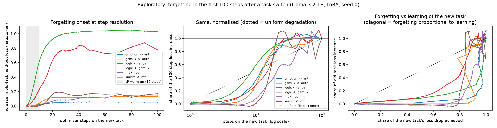
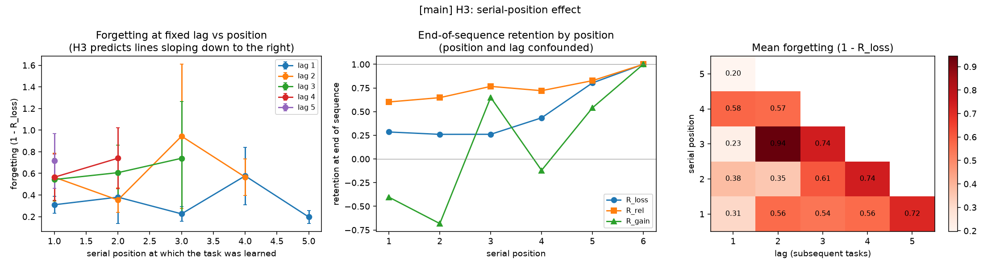

# The Forgetting Tax: Knowledge Erosion Across Task Domains During Continual Instruction Tuning

## 1. Executive Summary

**Question.** When a small instruction-tuned LLM is fine-tuned on six tasks one after another, does
performance on earlier tasks (H1) decay as a power law, (H2) decay 3-5x faster for reasoning tasks than
for pattern-matching tasks, and (H3) decay disproportionately for early-learned tasks?

**Answer.** None of the three parts of the hypothesis is supported as stated.

- **H1 (shape): uniform degradation is clearly rejected, but a power law is not what the individual
  curves look like.** Forgetting is front-loaded: each time training switches to a new task, old tasks
  take a hit that is essentially complete within 20-40 optimizer steps and then stays flat for the rest
  of the 250-step stage. A power law is the best of four candidates for the *averaged* Llama curves, but
  it is not the best description of individual trajectories (0 of 36 clear wins against an
  equal-parameter saturating exponential), it is not the best for the averaged Qwen curves, and at
  step resolution a saturating exponential beats it in 6 of 6 task pairs.
- **H2 (domain): no 3-5x gap.** On Llama-3.2-1B the reasoning/pattern forgetting ratio is 1.0-1.5
  depending on normalisation. On Qwen2.5-1.5B the metric-based ratios are 2.2-2.6 with wide intervals
  that do not survive multiple-comparison correction. Differences between tasks *within* a category
  are much larger than the difference between categories.
- **H3 (position): no reliable effect.** Once the amount of subsequent training is held fixed,
  early-learned tasks are not forgotten more on Llama (12 runs). On Qwen (6 runs) one loss-based
  measure shows the predicted direction, the metric-based measures do not.

**Practical implication.** In this setting the "tax" is charged per task switch, almost immediately,
and its size depends on the specific (old task, new task) pair rather than on a reasoning/pattern
label or on how early the task was learned. Evaluating shortly after a switch already shows most of
the damage; training longer on the new task adds little further loss.

Scope: two small models (1B and 1.5B parameters), LoRA only, naive sequential fine-tuning, six tasks,
200 test items per task. See Section 6.

## 2. Research Question & Motivation

Hypothesis as given: *knowledge erosion follows a power-law decay rather than uniform degradation, with
abstract reasoning tasks (math, logic) losing performance 3-5x faster than pattern-matching tasks
(translation, summarization), and early-learned tasks showing disproportionate forgetting compared to
recently acquired ones.*

Continual instruction-tuning benchmarks typically report one end-of-sequence average under one or two
fixed task orders. That leaves three things unmeasured: the shape of the trajectory, whether task type
matters independently of where the task sat in the order, and whether cross-task "rates" survive a
change of normalisation. This study measures all three with dense trajectories and a balanced order
design.

**Literature note.** The pipeline's resource-finding stage was skipped for this run
(`.neurico/pipeline_state.json`), so there is no `literature_review.md`, `papers/` or `code/`. The
background in `planning.md` (TRACE, CITB, Luo et al. 2023, Scialom et al. 2022) is from general
knowledge and was not checked against the papers in this session.

## 3. Experimental Setup

### Models and training
| | |
|---|---|
| Main model | `meta-llama/Llama-3.2-1B-Instruct` |
| Replication model | `Qwen/Qwen2.5-1.5B-Instruct` |
| Method | Naive sequential fine-tuning, one LoRA adapter carried through all tasks (r=16, alpha=32, no dropout, all attention and MLP projections) |
| Optimiser | AdamW, lr 2e-4, no weight decay, batch 16, grad-clip 1.0, constant LR with a 10-step linear warm-up at the start of every stage |
| Schedule | 250 steps per task (2 epochs of 2,000 examples), 6 tasks, 1,500 steps per run |
| Decoding | Greedy; bf16 autocast |
| Hardware | 4x NVIDIA RTX A6000 (48 GB), shared; peak 28 GB per process |

No API models were used: the study needs repeated fine-tuning with access to intermediate states, and
`OPENROUTER_KEY` is not set in this environment. API cost: $0.

### Tasks (2,000 train / 200 test each; prompts in `src/prep_data.py`)
| Task | Category | Source | Metric |
|---|---|---|---|
| gsm8k | reasoning | GSM8K, worked solution + `Answer: n` | exact match |
| arith | reasoning | synthetic 3-step integer arithmetic, worked steps | exact match |
| logic | reasoning | ProofWriter (OWA, depth 1-3), True/False/Unknown | accuracy |
| mt | pattern | WMT16 en->de | chrF |
| summ | pattern | SAMSum | ROUGE-L F1 |
| emotion | pattern | dair-ai/emotion, 6 classes | accuracy |

`emotion` gives the pattern category an accuracy-scored task so that category is not perfectly
confounded with metric type. The category assignment is a judgment call.

### Design
- **Orders.** 6-order Williams (balanced Latin-square) design: every task occupies every position once
  and follows every other task once. Llama: 2 blocks of 6 orders (seed 0 canonical; seed 1 a randomly
  relabelled square) = 12 runs. Qwen: 1 block = 6 runs.
- **Evaluation.** Held-out per-token loss on all six test sets every 25 steps; generation metrics every
  125 steps; zero-shot evaluation at step 0.
- **Baselines.** Zero-shot; each task's score at the end of its own stage; joint multi-task training
  for 1,500 steps on the mixture (Llama 2 seeds, Qwen 1 seed).
- **Onset experiment (added, exploratory).** For six (old <- new) pairs on Llama: train old task 250
  steps, then the new task for 100 steps, measuring old-task loss after every step up to step 20,
  every 2 steps to 50, every 10 to 100. One seed.

### Retention measures
With zero-shot value `m0`/`L0`, value at the end of the task's own stage `m*`/`L*`, and current value:
`R_loss = (L0-L)/(L0-L*)` (pre-registered primary for shape; 1 = just learned, 0 = zero-shot level, can
go negative), `R_rel = m/m*`, `R_gain = (m-m0)/(m*-m0)` (only where the gain is at least 0.05).
Reported in addition: `abs_drop = m*-m`, and `R_loss` clipped to [0,1] (added after seeing that a few
cells far below zero-shot level dominate the unclipped mean; labelled exploratory).

### Analysis (pre-registered in `planning.md` before any run)
H1: least-squares fits of linear, exponential, power `(1+t/tau)^-b` and exponential-to-asymptote,
compared by AICc, on mean curves and on individual trajectories. H2: ratio of category means of
forgetting over all stage-end cells with lag >= 1, tasks weighted equally, cluster bootstrap over runs
(10,000 resamples), plus an exact permutation test over the 20 ways of labelling 3 of 6 tasks
"reasoning". H3: forgetting at fixed lag vs position (Spearman) and OLS of forgetting on log(1+lag),
position and task with run-clustered errors. Deviations are logged at the end of `planning.md`.

### Compute
20 full runs, 29.5 GPU-process-hours in total; the GPUs were shared (with other users in the first
session and among my own concurrent runs throughout), so single runs took 60-110 minutes. The work
spans two sessions: the first was stopped by the pipeline's 4-hour limit after the 12 main runs; the
second ran the Qwen replication, the onset experiment, and all final analysis.

## 4. Results

### 4.1 Baselines
Mean task metric over the six tasks (per-task values in `results/{main,qwen}_baselines.csv`):

| | Zero-shot | End of own stage | Sequential, end of run | Joint multi-task |
|---|---|---|---|---|
| Llama-3.2-1B (12 runs; joint 2 seeds) | 0.460 | 0.624 | 0.499 | 0.623 |
| Qwen2.5-1.5B (6 runs; joint 1 seed) | 0.549 | 0.644 | 0.567 | 0.622 |

Joint training matches the single-task level, so the sequential shortfall is forgetting and not a
capacity limit of the adapter. Sequential training ends close to the zero-shot average: most of what
fine-tuning added is gone by the end. Mean backward transfer is -0.150 (Llama) and -0.093 (Qwen)
metric units.

Per-task, Llama:

| Task | Zero-shot | End of own stage | Sequential final (sd over runs) | Joint |
|---|---|---|---|---|
| gsm8k | 0.445 | 0.345 | 0.199 (0.085) | 0.302 |
| arith | 0.920 | 0.926 | 0.825 (0.165) | 0.942 |
| logic | 0.490 | 0.682 | 0.523 (0.179) | 0.765 |
| mt | 0.403 | 0.491 | 0.354 (0.148) | 0.481 |
| summ | 0.246 | 0.404 | 0.271 (0.112) | 0.395 |
| emotion | 0.255 | 0.896 | 0.820 (0.049) | 0.852 |

Fine-tuning *lowers* GSM8K accuracy below zero-shot (0.445 -> 0.345). The raw outputs show why: the
zero-shot model writes a long step-by-step solution (mean 657 characters), the fine-tuned model imitates
the terse GSM8K reference style (mean 231 characters) and makes more arithmetic slips. This is a
property of the training targets, not a scoring bug, but it means gain-normalised retention is undefined
for gsm8k and arith (no positive gain), and on Qwen also for mt.

### 4.2 H1 - shape of the forgetting curve

**Mean curves, lag axis in stages (pre-registered).** dAICc relative to the best model; position-1
tasks, 51 points per curve:

| Curve | linear | exponential | power | exp+asymptote | R^2 of best |
|---|---|---|---|---|---|
| Llama, all tasks, R_loss (12 traj.) | 78.5 | 47.9 | **0** | 14.1 | 0.81 |
| Llama, reasoning, R_loss | 38.3 | 14.5 | **0** | 4.2 | 0.68 |
| Llama, pattern, R_loss | 95.4 | 70.6 | **0** | 24.7 | 0.78 |
| Llama, all tasks, R_rel (11 points) | 27.1 | 23.6 | **0** | 5.0 | 0.94 |
| Qwen, all tasks, R_loss (6 traj.) | 82.5 | 28.9 | 8.7 | **0** | 0.35 |
| Qwen, reasoning, R_loss | 54.7 | 46.8 | 6.6 | **0** | 0.08 |
| Qwen, pattern, R_loss | 61.7 | **0** | 2.6 | 1.1 | 0.49 |

Linear decay is the worst model in every row. The power law wins on the Llama averages and loses on
the Qwen averages, where none of the four smooth curves fits well (R^2 at most 0.5).

**Individual trajectories (positions 1-3).** Best model by AICc:

| | linear | exponential | power | exp+asymptote |
|---|---|---|---|---|
| Llama, R_loss (36) | 9 | 4 | 2 | 21 |
| Llama, R_rel (36) | 9 | 16 | 3 | 8 |
| Qwen, R_loss (18) | 2 | 4 | 2 | 10 |
| Qwen, R_rel (18) | 5 | 6 | 3 | 4 |

Restricting to the two 2-parameter models (exploratory): on Llama the saturating exponential is
clearly better (dAICc > 2) in 26 of 36 trajectories, the power law in 0, 10 undecided; on Qwen 9 vs 2
with 7 undecided. So the power law describes the average better than it describes the things being
averaged. The per-task mean curves agree: exp+asymptote is best for 5 of 6 Llama tasks and 5 of 6 Qwen
tasks.

**Why smooth curves fit poorly: forgetting comes in steps.** Across the 108 Llama stage transitions in
which an old task's loss rose, the median share of the stage's rise that had already happened at the
first evaluation (25 of 250 steps) is 55%, and 72% by step 50; uniform degradation predicts 10% and
20%. Qwen: 39% and 66% (47 transitions). In 21% (Llama) and 24% (Qwen) of stage transitions an old
task's loss went *down*, i.e. the curves are not monotone.

**Step-resolution onset (exploratory, Llama, 6 pairs, 1 seed).**

| Old <- new | Loss rise after 100 steps (nats/token) | Share reached by step 10 / 20 / 50 | Steps to 50% / 90% of the rise | New task: steps to 50% / 90% of its loss drop | dAICc power vs saturating exp |
|---|---|---|---|---|---|
| logic <- arith | 1.028 | 0.60 / 0.90 / 1.01 | 9 / 20 | 4 / 6 | +74.9 |
| logic <- gsm8k | 0.775 | 0.29 / 0.81 / 1.00 | 16 / 24 | 6 / 26 | +38.4 |
| summ <- mt | 0.171 | 0.01 / 0.94 / 1.00 | 17 / 20 | 4 / 34 | +15.0 |
| mt <- summ | 0.140 | 0.08 / 0.47 / 0.85 | 22 / 70 | 5 / 22 | +21.0 |
| gsm8k <- arith | 0.132 | 0.30 / 0.87 / 0.90 | 13 / 42 | 3 / 6 | +31.5 |
| emotion <- arith | 0.053 | 0.37 / 0.79 / 1.05 | 12 / 26 | 4 / 6 | +52.0 |

The saturating exponential is the best of the four candidates in all six pairs; linear is worst in all
six (dAICc 32-149). Between step 50 and step 100 the old-task loss changes by at most 0.022 nats. The
curves are in fact slightly S-shaped: almost nothing happens in the first ~5 steps, which coincides
with the 10-step learning-rate warm-up, and forgetting lags behind learning of the new task (the new
task reaches half of its loss drop in 3-6 steps, the old task half of its loss rise in 9-22). The
warm-up is a property of this training recipe, so the delay may not generalise.

**H1 verdict: not supported as stated.** "Not uniform" holds strongly. "Power law" holds only for
averaged curves on one of two models. The data are better described as a rapid, saturating step at each
task switch whose size varies by task pair; summing such steps over a balanced set of interferers
gives a decelerating average curve that a power law fits well. That reading of the average is an
interpretation consistent with the fits above, not something this study tested directly.

### 4.3 H2 - reasoning vs pattern-matching

Forgetting = 1 - retention (or absolute drop), averaged over all stage-end evaluations after at least
one subsequent task. Ratio = reasoning / pattern, with cluster-bootstrap 95% CI over runs.

| Measure | Llama: reasoning / pattern | Llama ratio [95% CI] | Qwen: reasoning / pattern | Qwen ratio [95% CI] |
|---|---|---|---|---|
| R_loss (pre-reg.) | 0.637 / 0.434 | 1.47 [1.05, 1.91] | 0.610 / 0.103 | 5.93 [-12.9, 32.5] |
| R_rel (pre-reg.) | 0.286 / 0.251 | 1.14 [0.82, 1.60] | 0.210 / 0.096 | 2.18 [1.08, 3.52] |
| R_gain (pre-reg.; gsm8k, arith and Qwen mt excluded) | 0.843 / 0.954 | 0.88 [0.39, 1.56] | 0.505 / 0.399 | 1.27 [-0.05, 3.25] |
| abs_drop | 0.165 / 0.124 | 1.33 [0.89, 1.90] | 0.157 / 0.060 | 2.60 [1.21, 4.21] |
| R_loss clipped to [0,1] (exploratory) | 0.349 / 0.347 | 1.01 [0.82, 1.26] | 0.453 / 0.374 | 1.21 [0.72, 1.95] |

Per-task forgetting (the category means hide most of the structure):

| Task | Cat. | Llama abs_drop | Llama 1-R_rel | Llama 1-R_loss | Qwen abs_drop | Qwen 1-R_rel | Qwen 1-R_loss |
|---|---|---|---|---|---|---|---|
| gsm8k | R | 0.153 | 0.435 | 0.264 | 0.104 | 0.231 | 0.954 |
| arith | R | 0.168 | 0.186 | 0.109 | 0.282 | 0.288 | 0.562 |
| logic | R | 0.173 | 0.239 | 1.536 | 0.084 | 0.111 | 0.313 |
| mt | P | 0.167 | 0.338 | 0.940 | 0.027 | 0.057 | -0.044 |
| summ | P | 0.139 | 0.341 | 0.236 | 0.034 | 0.100 | 0.215 |
| emotion | P | 0.066 | 0.073 | 0.126 | 0.120 | 0.131 | 0.138 |

Reading the table:

- **Llama.** The only interval that excludes 1 is unclipped R_loss (bootstrap one-sided p = 0.016,
  Holm-adjusted over the three pre-registered measures 0.049). It is carried by one task: `logic`
  spends 43% of its cells *below zero-shot level* in loss terms, and without `logic` the ratio is 0.43.
  Clipping gives 1.01. The task-label permutation test gives p = 0.7. No measure comes near 3.
  In metric terms the reasoning tasks and two of the three pattern tasks lose about the same
  (0.14-0.17); only `emotion` is robust.
- **Qwen.** The metric-based ratios are above 2 and their intervals exclude 1 (one-sided p = 0.019 for
  R_rel, 0.017 for abs_drop) and overlap [3, 5]; after Holm correction over the three pre-registered
  measures the R_rel result is p = 0.057. Task-label permutation p = 0.2-0.3 (the smallest attainable
  value with 6 tasks is 0.1). The unclipped loss ratio of 5.9 is not interpretable: Qwen barely
  improves on mt and gsm8k in loss terms (L0 - L* = 0.033 and 0.078 nats), so the normalisation divides
  by nearly zero, as the interval shows.
- The largest metric drop on Qwen is `arith` (0.282), the smallest are `mt` and `summ` (about 0.03) -
  but Qwen also gained almost nothing on mt from fine-tuning, so there was little to lose.

**H2 verdict: not supported.** A 3-5x gap is absent on Llama under every normalisation. Qwen shows a
roughly 2-2.6x gap on metric-based measures that is suggestive but not robust to correction, to the
choice of normalisation, or to treating tasks (rather than runs) as the unit of generalisation. With
three tasks per category, this study cannot separate "reasoning vs pattern" from "these particular
tasks".

### 4.4 H3 - serial position

End-of-sequence retention does rise with position on both models (Llama R_rel: 0.60, 0.65, 0.77, 0.72,
0.83 for positions 1-5), but position and amount of subsequent training are the same thing there. The
tests below hold lag fixed.

| | Llama (12 runs) | Qwen (6 runs) |
|---|---|---|
| Lag-1 forgetting by position 1-5, R_loss clipped | 0.31, 0.21, 0.23, 0.38, 0.20 | 0.55, 0.51, 0.29, 0.23, 0.15 |
| Spearman position vs lag-1 forgetting, R_loss clipped (task-demeaned) | rho = -0.06, p = 0.65 | rho = -0.47, p = 0.009 |
| Same, R_rel | rho = 0.02, p = 0.87 | rho = -0.18, p = 0.34 |
| Same, R_loss unclipped | rho = -0.12, p = 0.37 | rho = -0.35, p = 0.055 |
| OLS position coefficient, R_loss clipped [95% CI] | -0.001 [-0.028, 0.026] | -0.073 [-0.138, -0.009] |
| OLS position coefficient, R_rel | -0.019 [-0.063, 0.025] | -0.019 [-0.047, 0.009] |
| OLS log(1+lag) coefficient, R_rel | 0.154 [0.015, 0.294] | -0.039 [-0.206, 0.128] |

A negative position coefficient is the direction H3 predicts (earlier-learned = more forgetting at the
same lag). Llama shows nothing. Qwen shows the predicted direction on the clipped loss measure and the
same sign but no significance on the metric measure; these p-values are uncorrected across four
measures and two models, and cluster-robust errors with six clusters are unreliable.

A second difference between the models: on Llama forgetting keeps accumulating with lag, on Qwen it
does not measurably do so after the first subsequent task (lag coefficient near zero).

**H3 verdict: not supported on Llama; inconclusive on Qwen.** The visible end-of-run disadvantage of
early tasks is explained by their longer exposure to interference on Llama.

### 4.5 What does predict forgetting? Pair structure and output format

Mean loss-based retention lost by an old task (row) during one stage of training on a new task
(column), Llama:

| old \ new | gsm8k | arith | logic | mt | summ | emotion |
|---|---|---|---|---|---|---|
| gsm8k | | 0.21 | 0.17 | 0.03 | 0.04 | 0.05 |
| arith | 0.00 | | 0.16 | -0.05 | -0.09 | 0.14 |
| logic | 1.11 | 1.63 | | -0.57 | 0.91 | -0.18 |
| mt | -0.01 | -0.04 | 0.14 | | 0.78 | 0.83 |
| summ | -0.03 | 0.02 | 0.13 | 0.17 | | 0.12 |
| emotion | -0.02 | 0.19 | 0.04 | 0.02 | 0.02 | |

A handful of pairs carry most of the forgetting (logic after arith/gsm8k/summ; mt after summ/emotion),
and some pairs produce recovery (logic after mt). On Llama same-category pairs average 0.435 against
0.039 for cross-category pairs, but this rests on those few cells and does not replicate on Qwen
(-0.219 vs 0.023, where the mt row is distorted by the near-zero loss denominator). The Qwen matrix is
in `results/qwen_interference_matrix.csv`; there `logic` is the most damaging *interferer* rather than
the most damaged task.

**Error analysis: format vs content.** Using the raw generations stored at stage ends, each output was
checked for having the requested form (e.g. contains `Answer:`; is one of the allowed labels; is not an
echo of the source).

| Task | Llama: format valid, just learned -> later | Llama: score given valid format, just learned -> later | Qwen: format valid, just learned -> later |
|---|---|---|---|
| gsm8k | 0.99 -> 0.70 | 0.35 -> 0.21 | 1.00 -> 0.75 |
| arith | 1.00 -> 0.73 | 0.93 -> 0.79 | 1.00 -> 0.68 |
| logic | 1.00 -> 0.73 | 0.68 -> 0.61 | 1.00 -> 0.96 |
| mt | 0.99 -> 0.62 | 0.49 -> 0.36 | 1.00 -> 0.99 |
| summ | 1.00 -> 0.75 | 0.40 -> 0.28 | 1.00 -> 0.96 |
| emotion | 1.00 -> 0.87 | 0.90 -> 0.84 | 1.00 -> 0.99 |

On Llama every task loses its output format in 13-38% of later outputs, and the score also falls among
outputs that keep the format, so both interface and content erode. On Qwen format loss is confined to
the two tasks with multi-line worked answers. Typical failure after a later task has been trained
(`results/main_example_outputs.json`): the arithmetic answer is written as prose without the `Answer:`
line after summarisation training; a GSM8K problem is paraphrased instead of solved.

### 4.6 Output locations
`results/runs/*.jsonl` raw per-evaluation records incl. generations at stage ends ·
`results/summary_{main,qwen}.json`, `results/extra_{main,qwen}.json`, `results/onset_summary.json` all
statistics quoted here · `results/*_trajectories.csv` long-format table · `figures/` ·
`results/partial_killed/` partial files of runs that were killed by out-of-memory in the first session
and restarted from scratch (not used in any analysis).

## 5. Discussion

**Against expectations.** The hypothesis pictured forgetting as a smooth process in training time with a
task-type-specific rate. What the trajectories show instead is an event-driven process: a switch of
training distribution causes a fast, bounded shift, after which continued training on the same new task
does little further harm. A "rate per step" is then not a natural quantity; "loss per switch, by pair"
is.

**Why the power law appears in averages.** The Llama average is well fit by a power law with a small
exponent, and so would be many decelerating curves. The equal-parameter comparison on individual
trajectories and the step-resolution experiment both favour saturation. I did not run a simulation
showing that the observed mixture of steps reproduces the averaged power-law fit, so this remains the
most economical reading rather than a demonstrated mechanism.

**Model dependence.** The two models disagree on which tasks are fragile (Llama: logic, mt; Qwen: arith,
gsm8k), on whether forgetting accumulates with lag, and on the category ratio. Any claim of a universal
reasoning-vs-pattern constant would need many more tasks and models than are here.

**Normalisation matters.** The same Llama data give a category ratio from 0.88 to 1.47 depending on the
measure, and the same Qwen data from 1.2 to 5.9. Loss-normalised retention breaks down when fine-tuning
barely changes a task's loss. Cross-task forgetting numbers quoted without their normalisation are not
comparable.

## 6. Limitations

- **Scale and method.** 1B and 1.5B models, LoRA r=16, one learning rate, 250 steps per task, no
  replay or regularisation. The planned full-fine-tuning ablation was cancelled (GPU contention, then
  time), so nothing here speaks to full fine-tuning or to larger models.
- **Tasks.** Six tasks, three per category, with a debatable category assignment; tasks are the real
  unit of generalisation for H2 and there are too few for a powerful test.
- **Gains were small or negative for some tasks.** Fine-tuning hurt gsm8k accuracy and did not improve
  arith (both models) or mt (Qwen). Forgetting of something that was barely learned is hard to define;
  gain-normalised results rest on 3-4 tasks.
- **Test size.** 200 items per task: single accuracy differences below about 7 points are within
  sampling error; conclusions rest on aggregates over runs.
- **Seeds and orders are not separated.** The two Llama blocks differ in both seed and order set; Qwen
  has one block and one joint-baseline seed.
- **Onset experiment.** One seed, six hand-picked pairs (chosen partly because they showed strong
  interference in the main runs), Llama only, losses only. The S-shaped start coincides with the LR
  warm-up and was not tested without it.
- **Curve fitting.** All four pre-registered models are monotone and start at 1; real trajectories are
  non-monotone in over 20% of transitions. AICc treats the 51 points of a mean curve as independent,
  which they are not, so the dAICc magnitudes overstate certainty; the win counts are the safer evidence.
- **Exploratory analyses.** The clipped loss measure, within-stage fits, equal-parameter comparison,
  sensitivity checks and the onset experiment were added after seeing the main results and are labelled
  as such.
- **Format-validity heuristics** are simple string rules and were not validated by hand beyond spot
  checks.
- **Reproducibility.** Runs are seeded, but out-of-memory handling changes micro-batch sizes, so
  floating-point summation order can differ between repeats; exact bit-level reproduction is not
  expected. No training run was repeated to measure this. The analysis scripts are deterministic and
  were re-run with identical output.
- **No literature review** was available in this run (see Section 2).

## 7. Conclusions & Next Steps

In naive sequential LoRA instruction tuning of two small LLMs, forgetting is neither uniform nor well
described as a per-task power law: it arrives as a fast, saturating hit at each task switch. Reasoning
tasks are not forgotten 3-5x faster than pattern-matching tasks (about 1x on Llama, about 2x with wide
uncertainty on Qwen), and early-learned tasks are not forgotten disproportionately once exposure is
controlled on Llama. Which specific task follows which is the strongest visible determinant.

Follow-ups, in order of value:
1. Repeat the onset experiment without warm-up, at several learning rates, with more seeds and on
   Qwen, to see whether the saturation time scales with learning rate (as a step-size effect would).
2. Test whether the per-switch hit is predictable from the gradient or representation overlap between
   the two tasks, which the pair matrix suggests.
3. Run 15-20 tasks per category so that category can be tested with tasks as the unit.
4. Reinstate the full-fine-tuning ablation and add a larger model.
5. Simulate averaged curves from the fitted per-switch steps to check directly whether aggregation
   alone reproduces the power-law fit.

## References
- Cobbe et al. 2021, GSM8K. · Tafjord et al. 2021, ProofWriter. · Bojar et al. 2016, WMT16. ·
  Gliwa et al. 2019, SAMSum. · Saravia et al. 2018, CARER (dair-ai/emotion).
- Wang et al. 2023, TRACE. · Zhang et al. 2023, CITB. · Luo et al. 2023, An Empirical Study of
  Catastrophic Forgetting in LLMs during Continual Fine-tuning. · Scialom et al. 2022. (Cited from
  memory; not re-read in this run.)
- Hu et al. 2021, LoRA. · Williams 1949, balanced cross-over designs.
- Software: Python 3.14.2, PyTorch 2.14.1 (CUDA 13.0), transformers 5.19.0, peft 0.21.2, SciPy 1.18.1,
  statsmodels 0.15.0, NumPy 2.5.3, pandas 3.0.6; full list in `requirements.txt` / `uv.lock`.
